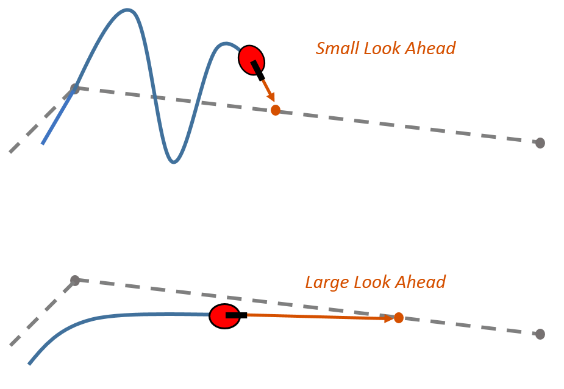

# Apuntes de estudio: control lateral y MPC

> Esqueleto con fórmulas. El texto en cursiva entre corchetes lo sustituyes tú con tus palabras.
> Lo que no tengas claro: `> DUDA: ...`

---

## 1. El problema del seguimiento de trayectoria

### 1.1 Idea
 
 El controlador lateral tiene que llevar a 0 dos errores, y solo puede para ello actuar sobre una variable de entrada $\delta$. Los errores son: 
 - Error lateral $e_y$; a cuantos metros estoy de la línea que marca la trayectoria que quiero seguir.
 - Error de rumbo: cuanto se desvía mi morro respecto a la dirección de la línea en ese punto. 

### 1.2 Física

La desviación respecto a la trayectoria es $e_y$. Puedo estar desviado 0cm pero torcido 3-4º y eso me llevará a que en el próximo segundo me haya salido de la trayectoria. 

Ejemplo de un tractor en ladera, este se escurre y se tuerce. Para corregir esa desviación el controlador mantiene el morro hacia arriba para ir compensando y mantener la trayectoria.  

### 1.3 Matemáticas

Errores de seguimiento respecto al punto más cercano de la trayectoria:

$$
e_y = \text{distancia con signo del vehículo a la trayectoria} \quad (+\ \text{izquierda})
$$

$$
e_\psi = \psi - \psi_{ref}
$$

Evolución del error lateral:

$$
\dot e_y = v_x \sin e_\psi + v_y \cos e_\psi \;\approx\; v_x\, e_\psi + v_y \qquad (e_\psi \text{ pequeño})
$$

Cadena causal (del actuador al error):

$$
\delta \;\rightarrow\; F_{yd} \;\rightarrow\; r \;\rightarrow\; \psi \,(e_\psi) \;\rightarrow\; e_y
$$

Ejemplo numérico (hipótesis: $v_y \approx 0$, $e_\psi$ constante, sin corrección):

$$
e_y(1\,\text{s}) \approx v_x \sin(e_\psi)\, t = 20 \cdot \sin(3^\circ) \cdot 1 \approx 1{,}05\ \text{m}
$$

Límite físico de corrección (agarre):

$$
|a_y| \lesssim \mu\, g
$$

| Símbolo | Significado | Unidades |
|---|---|---|
| $e_y$ | Error lateral (cross-track error) | m |
| $e_\psi$ | Error de rumbo | rad |
| $\psi$ | Rumbo (guiñada) del vehículo | rad |
| $\psi_{ref}$ | Rumbo de la trayectoria en el punto más cercano | rad |
| $v_x,\ v_y$ | Velocidades longitudinal y lateral (ejes del coche) | m/s |
| $r$ | Velocidad de guiñada | rad/s |
| $\delta$ | Ángulo de dirección | rad |
| $\mu$ | Coeficiente de adherencia | – |

### 1.4 Relación con el código MATLAB
- Estado: `z = [X, Y, psi, vx, vy, r]`. Los valores de *[¿Están e_y y e_ψ en z? ¿Quién los calcula y con qué?]*
- Actuador: `u(2) = delta`.
- Trayectoria: `path` = lista de puntos [x y] (P4).
- Saturación del agarre: `Fyd`, `Fyt` en `pasoDinamico`.

### 1.5 Fuentes
- P4, *Seguimiento de trayectoria* (D. Rodríguez), introducción y cross-track error.
- Tema 2.2, *Neumáticos y dinámica lateral* (D. Rodríguez). *[diapositiva]*
- *[Externa, si la usas: indícalo]*

### 1.6 Dudas abiertas
> DUDA:

---

## 2. Controladores geométricos: Pure Pursuit

### 2.1 Idea
En la trayectoria del coche, selecciono un punto a una distancia fija por delante del coche $L_d$ (look-ahead). Obtengo el arco de circunferencia que va desde el coche hasta el punto y coloco el volante $\delta$ para recorrer ese arco. 

Cuando el coche avanza el punto avanza con él y se va recalculando todo de nuevo todo el rato. 

### 2.2 Física
Equivale a la forma en la que conducimos en la vida real, miramos a un punto en la carretera que se encuentra unos metros delante nuestra, no miramos el asfalto que hay delante de las ruedas. 

En el tractor ocurre lo mismo, miras al final de la pasada y no a la rueda.

### 2.3 Matemáticas

Hipótesis: modelo **cinemático** de bicicleta (ruedas sin deriva, $\alpha_d = \alpha_t = 0$), punto de referencia en el eje trasero.

Punto objetivo: punto de la trayectoria a distancia $L_d$ del vehículo. Ángulo entre el rumbo y la recta al punto objetivo:

$$
\alpha = \operatorname{atan2}(Y_{obj} - Y,\; X_{obj} - X) - \psi
$$

Geometría del arco (la cuerda $L_d$ subtiende el arco de radio $R$):

$$
L_d = 2R \sin\alpha \;\Rightarrow\; \kappa = \frac{1}{R} = \frac{2\sin\alpha}{L_d}
$$

Bicicleta cinemática (relación dirección–radio):

$$
\tan\delta = \frac{L}{R} = L\,\kappa
$$

Ley de control:

$$
\boxed{\;\delta = \arctan\!\left(\frac{2L\sin\alpha}{L_d}\right)\;}
$$

Distancia de anticipación dependiente de la velocidad:

$$
L_d = k_v\, v_x + L_{d,min}
$$

| Símbolo | Significado | Unidades |
|---|---|---|
| $L_d$ | Distancia de anticipación (look-ahead) | m |
| $\alpha$ | Ángulo entre el rumbo y la recta al punto objetivo | rad |
| $R,\ \kappa$ | Radio y curvatura del arco | m, 1/m |
| $L = l_d + l_t$ | Batalla | m |
| $k_v$ | Ganancia de anticipación con la velocidad | s |
| $L_{d,min}$ | Anticipación mínima (a baja velocidad) | m |

### 2.4 Relación con el código MATLAB
- Función: `[delta, mem] = controlLateral(est, path, p, mem)` (P4).
- `mem.idx`: Es una limitación en el número de puntos por delante del coche que miro. En vez de buscar los 240 puntos en la pista solo permito elegir 20 por delante del coche.
- Batalla: `L = p.ld + p.lt`.
- Error medido con `errorLateral(x, y, path)` (P4), positivo a la izquierda.
- *[Punto de referencia: ¿la P4 usa el CG (X, Y de `z`) o el eje trasero? Compruébalo.]*

### 2.5 Limitaciones
- Pure Pursuit supone un modelo cinemático, con las ruedas sin deriva. En cambio nuestro pasoDinamico tiene deriva (v_y, αd, αt) y saturación de Fyd y Fyt. Como esto no lo contempla nuestro control a alta velocidad, o cerca del límite de agarre, el coche no recorre el arco calculado y el controlador no lo sabe. 

- Recorta curvas, esto ocurre porque el punto objetivo está lejos, ya dentro de la curva, y la cuerda que va del coche a ese punto pasa por el interior de la curva. El coche apunta a ese punto “atajando” y además el arco que calcula es más abierto que la curva real.

- Oscila cuadno tomamos una distancia $L_d$ demasiado pequeña, busca ese punto pero al llegar por la ganancia se pasa y tiene que volver a corregir. Tal y como se ve en la figura. Es un control P con una ganancia enorme.

- A alta velocidad tenemos que aumentar la distancia $L_d$  ya que la distancia que recorremos en cada instante es mayor y por lo tanto tenemos que tener en cuenta esa distancia que recorremos mientras ajustamos el giro del volante.

### 2.6 Fuentes
- P4, *Seguimiento de trayectoria* (D. Rodríguez).
- Coulter, R. C. (1992). *Implementation of the Pure Pursuit Path Tracking Algorithm*. CMU-RI-TR-92-01.
- https://es.mathworks.com/help/robotics/ug/pure-pursuit-controller.html
- https://thomasfermi.github.io/Algorithms-for-Automated-Driving/Control/PurePursuit.html

### 2.7 Dudas abiertas
> DUDA:

## 2b. Controlador Stanley

### 2b.1 Idea

Mira donde se encuentran las ruedas delanteras en ese instante y lo que hace es, primero las pone paralelas a la trayectoria, y luego aplica un giro extra para acercarte a la trayectoria. Este "giro extra" dependerá de lo lejos que esté de la trayectoria. 

### 2b.2 Física
Tengo dos situaciones: 
- Tengo el coche muy desviado de la trayectoria y por tanto un error muy grande. En este caso lo que ocurre es que se orientan las ruedas directamente hacia la trayectoria. 
- Tengo el coche cerca de la trayectoria y por tanto un error mucho más pequeño. Lo que ocurre es se sitúan las ruedas paralelas a la trayectoria y luego lo que se hace es aplicar un factor para ir reduciendo cada vez más ese error. 

¿ Y la velocidad cómo afecta ? 
Pues afecta a la cantidad de volante que aplico. A mayor velocidad menor volante para un mismo error y viceversa.

### 2b.3 Matemáticas

Hipótesis: bicicleta con rigidez de neumático infinita (sin deriva); error medido en el **eje delantero**.

Ley de control (Thrun et al. 2006, ec. 7, con la convención del artículo):

$$
\delta(t) = \psi(t) + \arctan\!\left(\frac{k\, x(t)}{u(t)}\right)
$$

donde $\psi(t)$ es el rumbo **relativo a la trayectoria** y $x(t)$ el error lateral del eje delantero.

Con nuestra convención ($e_y$ + izquierda, $e_\psi = \psi - \psi_{ref}$), ambos términos corrigen en sentido contrario al error:

$$
\delta = -\,e_\psi \;-\; \arctan\!\left(\frac{k\, e_{y,d}}{k_s + v_x}\right)
$$

($k_s$: término de suavizado para que no divida por cero a baja velocidad; es una adición habitual, **no** está en la ec. 7.)

Dinámica del error resultante (ec. 8–9):

$$
\dot x = -u \sin\!\left(\arctan\frac{k x}{u}\right) \;\Rightarrow\; x(t) \approx x(0)\, e^{-k t} \quad (x \text{ pequeño})
$$

| Símbolo | Significado | Unidades |
|---|---|---|
| $e_{y,d}$ | Error lateral medido en el eje delantero | m |
| $e_\psi$ | Error de rumbo | rad |
| $k$ | Ganancia (velocidad de convergencia) | 1/s |
| $k_s$ | Suavizado a baja velocidad | m/s |
| $u = v_x$ | Velocidad longitudinal | m/s |

### 2b.4 Comparación con Pure Pursuit
| | Pure Pursuit | Stanley |
|---|---|---|
| Punto de referencia | Eje trasero, mirando un punto $L_d$ por delante | Eje delantero, punto más cercano a la pista |
| Usa e_ψ explícitamente | No | Sí |
| Parámetro a ajustar | $L_d$ | k |
| Modelo que supone | Cinemático | Cinemático |

### 2b.5 Relación con el código MATLAB
- *[¿Qué punto es el eje delantero a partir de X, Y, psi de `z` y `p.ld`?]*
- ¡Comprueba el signo de `delta` en `pasoDinamico` antes de implementarlo!

### 2b.6 Fuentes
- Thrun, S. et al. (2006). *Stanley: The Robot that Won the DARPA Grand Challenge*. J. Field Robotics 23(9), 661–692. **Sección 9.2, ec. 7–9.** En el repo: `T1-Vhsistctrol/lecturas_complementarias/thrun.stanley05.pdf`.

### 2b.7 Dudas abiertas
> DUDA:

## 3. Modelo de bicicleta lineal en errores

### 3.1 Idea

El ojetivo es predecir que va a ocurrir para que el controlador utilice esa predicción para llevar a cero esos errores. 

### 3.2 Física

Al girar la dirección esto primero afectará a las velocidades tanto del error lateral como del rumbo, posteriormente esto se traducirá en un cambio en el rumbo y finalmente se verá reflejado en el error lateral reduciéndose esa distancia de error con la deseada. 

Ejemplo: si giro 2º el ángulo el rumbo y el desplazamiento cambiarán de forma proporcional, y por tanto si antes conseguía 21 cm de desplazamiento lateral en 0,5 seg si ahora tomo 4º tendré de forma lineal un desplazamiento de 42 cm en 0,5. 

El giro del volante hace que aparezca una fuerza lateal que desencadena todo pero hay un límite y este viene dado por el agarre. Satura y ya no conseguimos por mucho más que giremos que nos de más fuerza lateral. 

El modelo lineal no conoce ese límite y por eso solo funciona para fuerzas lejos del límite. 

### 3.3 Matemáticas

**Hipótesis**
- $v_x$ constante durante la predicción (se actualiza en cada paso → modelo que cambia con la velocidad).
- Ángulos pequeños; neumático **lineal**, $F_y = C\,\alpha$ (**sin** la saturación de `pasoDinamico`).
- $C_d, C_t$: rigidez de deriva **por eje** (`p.Cad`, `p.Cat`). *Ojo: Rajamani usa $2C_\alpha$ por rueda.*

**Paso 1. Bicicleta lineal en $[v_y,\ r]$** (la misma física que `pasoDinamico`, sin saturar):

$$
\dot v_y = -\frac{C_d + C_t}{m\,v_x}\,v_y + \left(\frac{-C_d l_d + C_t l_t}{m\,v_x} - v_x\right) r + \frac{C_d}{m}\,\delta
$$

$$
\dot r = \frac{-C_d l_d + C_t l_t}{I_z\,v_x}\,v_y - \frac{C_d l_d^2 + C_t l_t^2}{I_z\,v_x}\,r + \frac{C_d\,l_d}{I_z}\,\delta
$$

**Paso 2. Cambio a errores** (del concepto 1): $\dot e_y = v_y + v_x e_\psi$, $\;\dot e_\psi = r - \dot\psi_{ref}$, con $\dot\psi_{ref} = v_x\,\kappa$.

**Resultado:** estado $x = [\,e_y,\ \dot e_y,\ e_\psi,\ \dot e_\psi\,]^T$

$$
\dot x = A\,x + B\,\delta + E\,\dot\psi_{ref}
$$

$$
A=\begin{bmatrix}
0 & 1 & 0 & 0\\[2pt]
0 & -\dfrac{C_d+C_t}{m v_x} & \dfrac{C_d+C_t}{m} & \dfrac{-C_d l_d + C_t l_t}{m v_x}\\[8pt]
0 & 0 & 0 & 1\\[2pt]
0 & -\dfrac{C_d l_d - C_t l_t}{I_z v_x} & \dfrac{C_d l_d - C_t l_t}{I_z} & -\dfrac{C_d l_d^2 + C_t l_t^2}{I_z v_x}
\end{bmatrix}
$$

$$
B=\begin{bmatrix} 0 \\ \dfrac{C_d}{m} \\ 0 \\ \dfrac{C_d\, l_d}{I_z} \end{bmatrix}
\qquad
E=\begin{bmatrix} 0 \\ \dfrac{-C_d l_d + C_t l_t}{m v_x} - v_x \\ 0 \\ -\dfrac{C_d l_d^2 + C_t l_t^2}{I_z v_x} \end{bmatrix}
$$

La matríz B tiene ceros en el error lateral y en el error de rumbo ya que los cambios en la dirección no producen cambios inmediatos en esas variables. Los camibos ocurren en los siguientes instantes de la simulación. 

**Paso 3. Discretización** (para el controlador digital y el MPC), con Euler como `pasoDinamico`:

$$
x_{k+1} = A_d\,x_k + B_d\,\delta_k + E_d\,\dot\psi_{ref,k},\qquad A_d \approx I + A\,\Delta t,\quad B_d \approx B\,\Delta t,\quad E_d \approx E\,\Delta t
$$

| Símbolo | Significado | Unidades |
|---|---|---|
| $e_y,\ \dot e_y$ | Error lateral y su derivada | m, m/s |
| $e_\psi,\ \dot e_\psi$ | Error de rumbo y su derivada | rad, rad/s |
| $C_d,\ C_t$ | Rigidez de deriva eje delantero / trasero | N/rad |
| $l_d,\ l_t$ | Distancia CG–eje delantero / trasero | m |
| $m,\ I_z$ | Masa, inercia en guiñada | kg, kg·m² |
| $\kappa$ | Curvatura de la trayectoria | 1/m |
| $\dot\psi_{ref}$ | Giro que "pide" la pista (perturbación conocida) | rad/s |

### 3.4 Relación con el código MATLAB
- Mismos parámetros que `pasoDinamico`: `p.m, p.Iz, p.ld, p.lt, p.Cad, p.Cat`.
- *[¿De dónde sale κ? Pista: de `path`, igual que ψ_ref.]*
- *[¿Qué partes de `pasoDinamico` NO están en este modelo? (mira las líneas de saturación y `vx_c`)]*
- Riesgo de integración: ninguno, el modelo vive **dentro del controlador**; la planta no se toca.

### 3.5 Fuentes
- Tema 2.2, *Neumáticos y dinámica lateral* (D. Rodríguez), modelo de bicicleta. *[diapositiva]*
- P2, *Modelo de bicicleta* (D. Rodríguez).
- **Externa:** Rajamani, R. (2012). *Vehicle Dynamics and Control*, 2ª ed., Springer. Cap. 2, secciones 2.3 (bicicleta) y 2.5 (modelo en errores).

### 3.6 Dudas abiertas
> DUDA:

## 4. Regulador cuadrático lineal (LQR)

### 4.1 Idea
*[Con tus palabras, 2–3 frases. Puntos clave:]*
- *[La ley es δ = −K·x: suma de los 4 errores por 4 ganancias (misma forma que Stanley linealizado).]*
- *[Las ganancias no se eligen a mano: se calculan con el modelo (A, B) minimizando un coste.]*

### 4.2 Física
*[Con tus palabras. Puntos clave:]*
- *[Qué significa Q (cuánto me importa cada error) y R (cuánto me cuesta mover el volante). El compromiso precisión ↔ suavidad.]*
- *[Por qué pesar solo e_y hace oscilar (tu respuesta: llega torcido, cruza la línea, zigzag). e_ψ y las derivadas actúan de amortiguador.]*
- *[En curva queda un e_ψ ≠ 0 en régimen permanente aunque e_y → 0: lo mismo que el tractor en ladera.]*

### 4.3 Matemáticas

Modelo (concepto 3, discreto):

$$
x_{k+1} = A_d\,x_k + B_d\,\delta_k, \qquad x = [\,e_y,\ \dot e_y,\ e_\psi,\ \dot e_\psi\,]^T
$$

Coste a minimizar (horizonte infinito):

$$
J = \sum_{k=0}^{\infty} \left( x_k^T Q\, x_k + R\,\delta_k^2 \right), \qquad Q = \operatorname{diag}(q_1, q_2, q_3, q_4) \succeq 0,\quad R > 0
$$

Solución: realimentación de estado

$$
\boxed{\;\delta_k = -K\,x_k = -(k_1 e_y + k_2 \dot e_y + k_3 e_\psi + k_4 \dot e_\psi)\;}
$$

$$
K = \left(R + B_d^T P B_d\right)^{-1} B_d^T P A_d
$$

donde $P$ es la solución de la ecuación de Riccati discreta (DARE):

$$
P = A_d^T P A_d - A_d^T P B_d \left(R + B_d^T P B_d\right)^{-1} B_d^T P A_d + Q
$$

Prealimentación por curvatura (opcional, para no esperar al error en curva):

$$
\delta = -K\,x + \delta_{ff}, \qquad \delta_{ff} \approx L\,\kappa \quad (\text{aprox. cinemática; Rajamani da la expresión completa con subviraje})
$$

Punto de partida para elegir pesos (regla de Bryson):

$$
q_i = \frac{1}{(\text{error máximo aceptable en } x_i)^2}, \qquad R = \frac{1}{\delta_{max}^2}
$$

| Símbolo | Significado | Unidades |
|---|---|---|
| $K$ | Vector de ganancias $[k_1\ k_2\ k_3\ k_4]$ | rad/m, rad·s/m, –, s |
| $Q$ | Pesos de los errores | – |
| $R$ | Peso del volante | – |
| $P$ | Solución de Riccati ("coste futuro" de cada estado) | – |
| $\delta_{ff}$ | Volante de prealimentación por curvatura | rad |
| $\kappa$ | Curvatura de la pista | 1/m |

### 4.4 Relación con el código MATLAB
- `K = dlqr(Ad, Bd, Q, R);` → `delta = -K*x + delta_ff;` (Control System Toolbox: *[¿la tienes?]*)
- `Ad, Bd` dependen de `vx = z(4)` → recalcular `K` en cada paso, o tabularla por velocidades (*gain scheduling*).
- `x` = [e_y, ė_y, e_ψ, ė_ψ]: e_y y e_ψ como en Stanley/`errorLateral`; ė_y = v_y + v_x·e_ψ; ė_ψ = r − v_x·κ.
- Saturación a posteriori: `delta = max(min(delta, dmax), -dmax)` → LQR no lo sabe (como el antiwindup, tema 3.3 diap. 8).
- Riesgo de integración: ninguno en la planta; todo dentro de `controlLateral`.

### 4.5 Limitaciones
- No conoce restricciones (tope de volante, agarre): se recorta después.
- No anticipa la curva salvo con $\delta_{ff}$.
- Modelo lineal: fuera de la zona lineal del neumático pierde validez.
- → Estas tres son justo lo que resuelve el MPC (mismo coste, horizonte finito, restricciones, curvas futuras).

### 4.6 Fuentes
- **Externa:** Rajamani, R. (2012). *Vehicle Dynamics and Control*, 2ª ed., Springer. Cap. 3 (control lateral por realimentación de estado y prealimentación).
- **Externa:** Brunton, S. *Control Bootcamp*, vídeo de LQR (YouTube).
- Conexión con el temario: tema 3.3 (diap. 8: saturación a posteriori; diap. 12: MPC como generalización).

### 4.7 Dudas abiertas
> DUDA:

## 5. Control predictivo (MPC) lateral

### 5.1 Idea
*[En 2–3 frases: el ciclo medir → predecir → optimizar → aplicar solo el primero → repetir. Diferencia con LQR.]*

### 5.2 Física
*[Por qué anticiparse a la curva importa (cadena δ → r → ψ → e_y). Qué significa "respetar el agarre". Qué pasa si el horizonte es demasiado corto (tema 3.3, diap. 14).]*

### 5.3 Matemáticas

En cada instante $k$, con el estado medido $x_0$ y las curvaturas futuras de la pista $\kappa_0,\dots,\kappa_{N-1}$, resolver:

$$
\min_{\delta_0,\dots,\delta_{N-1}} \;\; \sum_{i=0}^{N-1}\Big( x_i^T Q\, x_i + R\,\delta_i^2 + S\,(\delta_i - \delta_{i-1})^2 \Big) \;+\; x_N^T P\, x_N
$$

sujeto a:

$$
\begin{aligned}
x_{i+1} &= A_d\,x_i + B_d\,\delta_i + E_d\,\dot\psi_{ref,i} && \text{(modelo interno, concepto 3)}\\
|\delta_i| &\le \delta_{max} && \text{(tope de dirección)}\\
|\delta_i - \delta_{i-1}| &\le \Delta\delta_{max} && \text{(velocidad del actuador)}\\
|v_x\, r_i| &\lesssim \mu\, g && \text{(agarre, aproximado)}
\end{aligned}
$$

Aplicar **solo** $\delta_0$, descartar el resto y repetir en $k+1$ (horizonte deslizante).

Como el modelo es lineal y el coste cuadrático → es un **QP** (programa cuadrático), que se resuelve rápido.

| Símbolo | Significado |
|---|---|
| $N$ | Horizonte de predicción (pasos); $N\,\Delta t$ = segundos que "mira" hacia delante |
| $Q,\ R$ | Pesos de errores y de volante (como en LQR) |
| $S$ | Peso a los cambios bruscos de volante (suavidad) |
| $P$ | Coste terminal (p. ej. la $P$ de LQR) |
| $\dot\psi_{ref,i} = v_x\kappa_i$ | Curvatura **futura** de la pista: la "anticipación" |

### 5.4 Comparación LQR / MPC
| | LQR | MPC |
|---|---|---|
| Horizonte | *[ ]* | *[ ]* |
| Restricciones | *[ ]* | *[ ]* |
| Mira la curva que viene | *[ ]* | *[ ]* |
| Cálculo en cada paso | *[ ]* | *[ ]* |

### 5.5 Relación con el código MATLAB
- Mismo modelo interno que el concepto 3 (`Ad, Bd, Ed` con la `vx` actual).
- κ futuras: de `path`, a partir de `mem.idx` hacia delante.
- Resolver el QP: *[¿`quadprog` (Optimization Toolbox) o MPC Toolbox? Compruébalo.]*
- *[¿Cada cuánto se ejecuta el MPC frente a `dt` de la planta? Coste computacional (diap. 21).]*
- Riesgo de integración: ninguno en la planta. Riesgo **computacional**: tiempo de cálculo.

### 5.6 Limitaciones
- *[Modelo lineal: fuera de la zona lineal el modelo miente (concepto 3).]*
- *[Coste de cálculo y ajuste de N, Q, R, S.]*
- *[Más realismo ≠ más rendimiento: hay que demostrar la mejora frente a Pure Pursuit.]*

### 5.7 Fuentes
- Tema 3.3, *Introducción al MPC* (D. Rodríguez), diap. 12–15 (ciclo, horizonte, coste/restricción terminal) y 21.
- **Externa:** Borrelli, Bemporad, Morari (2017). *Predictive Control for Linear and Hybrid Systems*.
- **Externa:** Kabzan et al. (2020). *AMZ Driverless: The full autonomous racing system*. J. Field Robotics (MPC en FS Driverless).
- **Externa:** Liniger, Domahidi, Morari (2015). *Optimization-based autonomous racing of 1:43 scale RC cars*.

### 5.8 Dudas abiertas
> DUDA:
